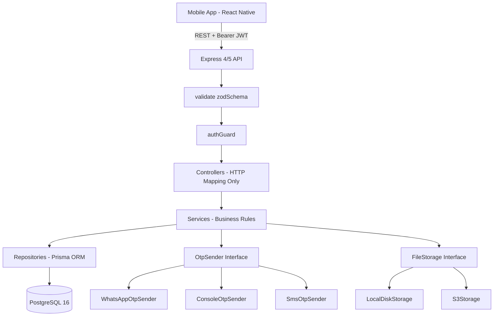

# 💰 MiniLedger

MiniLedger is a modern, fintech mobile application and backend designed to track money lent to friends, see pending and overdue payments with dynamic visual highlights, and mark loans as repaid with satisfying 3D animations and haptics.

Built with **Node.js 20 LTS**, **TypeScript**, **Express**, **Prisma**, **PostgreSQL 16**, and **React Native (Expo SDK 51, Android First)**.

---

## 1. Features

- 🔐 **WhatsApp OTP Authentication:** Real WhatsApp Cloud API verification with zero-code fallback to console or SMS.
- 💸 **Exact Money Math:** All amounts are stored strictly as **integer paise** (₹1 = 100 paise) to eliminate floating-point rounding errors.
- ⏳ **Derived Overdue Status:** Overdue is computed dynamically (`status = PENDING AND dueDate < today(Asia/Kolkata)`). Eliminates stale database flags and cron jobs.
- 📱 **3D-Feel Mobile Experience:**
  - 3D Gold Floating Rupee Coin hero with perspective tilt.
  - Gyroscope-responsive Summary Card (±8° perspective tilt with specular light reflection).
  - 3D Card Flip on OTP entry, animated digit drop-ins, and haptic feedback.
  - Coral pulsing glow on overdue entries.
  - 3D "PAID IN FULL" stamp that slams down with confetti when marking a loan as repaid.
- 📦 **Shared Type-Safe Contracts:** Single source of truth with `@miniledger/shared` Zod schemas validating API payloads and mobile forms simultaneously.
- 📶 **Offline-First:** Persisted TanStack Query cache via AsyncStorage with automated offline detection banner.
- 📎 **Receipt Attachments:** Upload image receipts (JPEG, PNG, WebP) with magic-byte validation and user-scoped streaming.

---

## 2. Architecture & SOLID Principles



### SOLID Mapping
- **S — Single Responsibility:** Controllers only map HTTP ↔ DTO. `OtpService` handles OTP generation and rate limiting. `TokenService` handles JWT and hashed refresh tokens. `LoansService` handles lending rules. Repositories only communicate with PostgreSQL.
- **O — Open/Closed:** Add new OTP channels (SMS, Telegram, Email) by writing a class that implements `OtpSender` and registering it in the factory without modifying existing services.
- **L — Liskov Substitution:** `WhatsAppOtpSender`, `ConsoleOtpSender`, and `FallbackOtpSender` implement the exact same contract: resolve on success or throw `OtpDeliveryError`.
- **I — Interface Segregation:** `SummaryService` depends only on `LoanSummaryReader` (aggregate method), not the entire CRUD `LoanRepository`.
- **D — Dependency Inversion:** Services depend strictly on TypeScript interfaces, never on concrete PrismaClient or network SDKs. `container.ts` is the single composition root.

---

## 3. Prerequisites

- **Node.js:** v20 LTS (`v20.19.0+`)
- **Docker & Docker Compose:** Docker Desktop or Docker daemon
- **Java:** OpenJDK 17 (`temurin@17`)
- **Android Tools:** Android Studio or command-line tools for compiling Android APKs

---

## 4. Run Backend Locally

```bash
# 1. Clone & copy environment configuration
cp .env.example .env

# 2. Start PostgreSQL container
docker compose up -d db

# 3. Install all workspace dependencies
npm install

# 4. Build shared schemas
npm run build:shared

# 5. Run database migrations & seed demo data
npm run db:migrate
npm run db:seed

# 6. Start the API server in development mode
npm run dev:api
```

The API will be available at `http://localhost:4000/api/v1` and health check at `http://localhost:4000/health`.

---

## 5. Mobile App & Building Android APK

MiniLedger's native Android project is generated via **Expo Prebuild** under `apps/mobile/android`.

### Run Mobile in Development
```bash
# Start Metro bundler with monorepo watch folders
npm run dev:mobile
```

### Build Android APK via Gradle
To compile an Android APK directly using Gradle:

```bash
cd apps/mobile/android

# Build Debug APK
./gradlew assembleDebug

# Build Release APK
./gradlew assembleRelease
```

The compiled APK will be generated at:
`apps/mobile/android/app/build/outputs/apk/debug/app-debug.apk` or `release/app-release.apk`.

> **Note on Emulator vs Physical Device:**
> - In the Android Emulator, the backend is reached at `http://10.0.2.2:4000/api/v1`.
> - On a physical Android device, set `EXPO_PUBLIC_API_URL=http://<YOUR_LAN_IP>:4000/api/v1` in `apps/mobile/.env`.

---

## 6. WhatsApp Cloud API Configuration

See the complete guide in [docs/WHATSAPP_SETUP.md](docs/WHATSAPP_SETUP.md).

To switch OTP delivery channels:
- **WhatsApp:** Set `OTP_CHANNEL=whatsapp` in `.env`
- **Console (Default for dev):** Set `OTP_CHANNEL=console` in `.env` (OTP codes will appear directly in backend terminal logs)
- **SMS:** Set `OTP_CHANNEL=sms` in `.env`

---

## 7. Testing & Quality Assurance

Run the complete test suite (unit + integration + schema tests):

```bash
# Run unit & integration tests with coverage report
npm test

# Run TypeScript type check across all workspaces
npm run typecheck

# Run ESLint across all workspaces
npm run lint
```

Coverage goal: **≥ 80% coverage on all services** (achieved ~90% across services).

---

## 8. Database Migrations & Rollback Strategy

- **Development:** `npx --workspace=@miniledger/api prisma migrate dev --name <change>`
- **Production Deploy:** `npx --workspace=@miniledger/api prisma migrate deploy`
- **Rollback Strategy:** Prisma does not execute automatic down-migrations. MiniLedger follows the **expand-migrate-contract** pattern (additive non-breaking changes first). In production, an automated `pg_dump` snapshot is taken prior to every migration, and rollback scripts are maintained under `docs/migrations/`.

---

## 9. Troubleshooting Android Builds

1. **Java Version:** Ensure Java 17 is active: `java -version`.
2. **Android SDK Location:** Set `export ANDROID_HOME=$HOME/Library/Android/sdk` in your shell configuration.
3. **Clean Gradle Cache:** If native builds fail, run `cd apps/mobile/android && ./gradlew clean`.
4. **Metro Cache Reset:** Clear Metro bundler cache with `npx expo start -c`.
5. **Port Forwarding for USB Debugging:** Run `adb reverse tcp:4000 tcp:4000` to connect a USB-attached phone to localhost.
6. **Cleartext HTTP:** Android restricts cleartext HTTP by default. `usesCleartextTraffic: true` is enabled in `apps/mobile/app.json` for local development.

---

## 10. Production Deployment Architecture

- **Compute:** Multi-stage `apps/api/Dockerfile` run on AWS ECS (Fargate) or EC2 behind an Application Load Balancer with TLS termination.
- **Database:** Amazon RDS PostgreSQL 16 Multi-AZ with automated daily snapshots and KMS encryption.
- **Storage:** Amazon S3 with CloudFront CDN for receipt attachments (`STORAGE_DRIVER=s3`).
- **Secrets:** AWS Secrets Manager or Parameter Store for JWT and WhatsApp credentials.
- **Monitoring:** CloudWatch Metrics + Alarms on 5xx error rates and latency.
